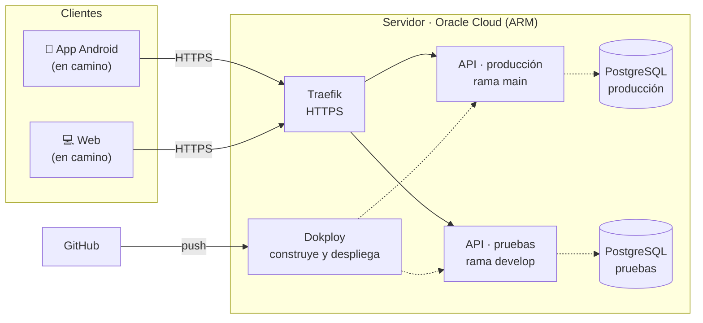
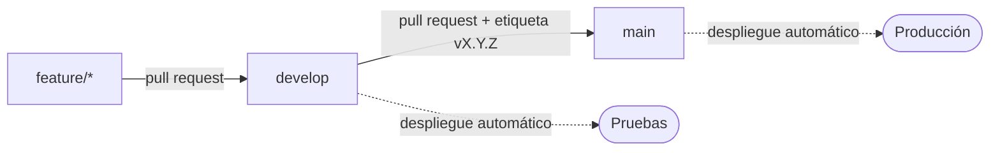

<div align="center">

# 🐄 Bovigest API

**El backend de Bovigest: el control de una finca ganadera, desde la parcela
hasta cada cabeza de ganado.**

[](https://github.com/CSagasDev/chivos-api/tags)
[](https://bovigest-api.datosystems.dev)


</div>

---

## ¿Qué es Bovigest?

Bovigest es una app para llevar el control de fincas ganaderas: el terreno
(fincas, parcelas, potreros), el ganado y su historia. Va a tener una versión
web y una app para Android, y las dos hablan con esta API.

Hoy el proyecto está en sus **cimientos**: la API ya corre en pruebas y en
producción, con HTTPS, despliegue automático y documentación interactiva. Las
funciones de la finca vienen encima de esto.

## Arquitectura



- **La API es pública; la base de datos no.** Solo la API habla con
  PostgreSQL, dentro del servidor.
- **Cada rama es un entorno.** Un push a `develop` despliega pruebas; un push a
  `main`, producción. Nadie despliega a mano.
- **El mismo código en todos lados.** Lo que cambia entre entornos son las
  variables, nunca el código.

## Tecnologías

| Pieza | Qué se usa |
|---|---|
| Lenguaje | TypeScript 6, en modo estricto |
| Framework | NestJS 12, con módulos ESM |
| Entorno | Node.js 26 |
| Paquetes | pnpm 12, con la versión fija en `packageManager` |
| Base de datos | PostgreSQL 18 |
| Pruebas | Vitest y Supertest |
| Documentación | OpenAPI con Swagger |
| Contenedores | Docker en dos etapas; Docker Compose para la laptop |
| Servidor | Dokploy y Traefik, con certificados de Let's Encrypt |

## Empezar

Necesitas **Node.js 26**, **pnpm 12** y **Docker**.

```bash
git clone https://github.com/CSagasDev/chivos-api.git
cd chivos-api
pnpm install

docker compose up -d db   # un PostgreSQL solo para tu laptop
pnpm start:dev            # la API, que se reinicia sola al guardar
```

Abre <http://localhost:3000>: te lleva a Swagger, donde puedes ver y probar
cada ruta.

¿Prefieres levantar todo como en el servidor? `docker compose up --build`
construye la imagen de la API y la arranca junto con la base.

## Comandos

| Comando | Qué hace |
|---|---|
| `pnpm start:dev` | Arranca la API y la reinicia al guardar |
| `pnpm build` | Compila TypeScript a JavaScript en `dist/` |
| `pnpm start:prod` | Corre lo compilado |
| `pnpm test` | Pruebas unitarias |
| `pnpm test:e2e` | Pruebas de la API completa, por HTTP |
| `pnpm test:cov` | Pruebas con cobertura |
| `pnpm lint` | Revisa el código en busca de errores comunes |
| `pnpm format` | Acomoda el formato con Prettier |

## Rutas

| Ruta | Qué contesta |
|---|---|
| `GET /health` | `{"status": "Ok"}` si la API está viva. Docker la consulta cada 30 segundos |
| `GET /` | Con Swagger, lleva a `/docs`. Sin Swagger, una ficha con el nombre y la versión |
| `GET /docs` | Swagger: la documentación interactiva |
| `GET /docs-json` | El plano de la API en formato OpenAPI |

## Variables de entorno

| Variable | Para qué | Si no está |
|---|---|---|
| `PORT` | Puerto en el que escucha la API | `3000` |
| `SWAGGER` | `true` enciende Swagger; cualquier otro valor lo apaga | Encendido fuera de Docker, apagado dentro |
| `NODE_ENV` | `production` dentro de Docker; lo pone el `Dockerfile` | — |
| `DATABASE_URL` | Conexión a PostgreSQL | Todavía no se usa |

`docker-compose.yml` trae una contraseña a la vista (`chivos`) a propósito: solo
abre la base de tu laptop, y solo desde `127.0.0.1`. Las contraseñas de verdad
viven en el servidor, nunca en el repo.

## Entornos

| Entorno | Rama | Swagger | Dirección |
|---|---|---|---|
| Laptop | cualquiera | Encendido | `http://localhost:3000` |
| Pruebas | `develop` | Encendido | No publicada |
| Producción | `main` | Apagado | <https://bovigest-api.datosystems.dev> |

## Cómo se trabaja



1. Cada cambio nace en su propia rama `feature/<nombre>`, a partir de
   `develop`.
2. Entra a `develop` por pull request, y se prueba en el entorno de pruebas.
3. Cuando `develop` está estable, pasa a `main` por pull request, con su
   número de versión ([versionado semántico](https://semver.org/lang/es/)).

## Estructura

```text
chivos-api/
├── src/
│   ├── main.ts            # arranca la app: Swagger, la ruta / y el puerto
│   ├── app.module.ts      # el módulo principal: solo junta los demás
│   └── health/            # un módulo por funcionalidad
├── test/                  # pruebas de la API completa
├── Dockerfile             # la imagen, en dos etapas
├── docker-compose.yml     # la API y PostgreSQL para la laptop
└── pnpm-workspace.yaml    # qué dependencias pueden correr scripts al instalarse
```

## Versiones

| Versión | Fecha | Qué trajo |
|---|---|---|
| [`v0.2.0`](https://github.com/CSagasDev/chivos-api/tree/v0.2.0) | 2026-11-18 | Swagger en pruebas, ficha de la API en producción y entorno local con Docker Compose |
| [`v0.1.0`](https://github.com/CSagasDev/chivos-api/tree/v0.1.0) | 2026-11-17 | Ruta de salud, imagen de Docker y primer despliegue |

## Lo que viene

- [x] API en pruebas y producción, con HTTPS
- [x] Despliegue automático por rama
- [x] Documentación interactiva con Swagger
- [ ] Conexión a PostgreSQL, con migraciones
- [ ] Pruebas automáticas en cada pull request
- [ ] Inicio de sesión, empresas y usuarios por invitación
- [ ] Fincas y sus divisiones: parcelas, potreros, corrales…
- [ ] Engorde: cada cabeza con su número, nombre y peso
- [ ] Crianza: padres, madres y crías, razas, crecimiento y celo
- [ ] Web y app para Android

---

<div align="center">

Hecho en Guatemala 🇬🇹 por **DATO Systems Group**

<sub>© 2026 DATO Systems Group. Todos los derechos reservados: el código se puede
ver, pero no es de uso libre.</sub>

</div>
